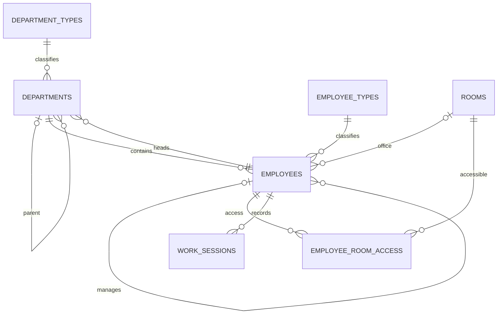
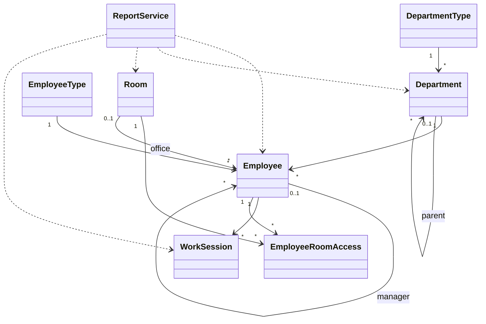

# Диаграммы проекта

## ER-диаграмма

## Диаграмма классов — концептуальная

## Use Case — перечень сценариев

Актор: «Пользователь системы».

- Вести сотрудников.
- Вести подразделения.
- Вести помещения.
- Вести типы сотрудников и подразделений.
- Назначать начальников и руководителей.
- Управлять доступом к помещениям.
- Начинать и завершать рабочие сессии.
- Формировать отчёт с обязательными фильтрами подразделений и помещений.
- Необязательно фильтровать результат по минимальным рабочим часам.

Для итоговой сдачи Use Case следует оформить как UML-диаграмму с границей системы, актором и овалами сценариев. Перечень здесь фиксирует содержание, а не претендует на графическую UML-нотацию.
